# TenantForge

[English](README.md)

[](https://github.com/ljn-forge/tenantforge/actions/workflows/ci.yml)
[](LICENSE)

面向 Go/Vue 开发者的多租户后台框架，附带完整的企业内部客服工单示例。

做一套服务多家公司的企业软件时，可以复用这里的账号、组织、角色、数据隔离和字段权限，集中开发自己的业务。内置示例将客服登记、主管分配、个人队列、沟通/内部备注、解决说明与关闭重开串成实际流程。

[从管理员到客服：跑通一张工单](docs/support-desk.md)

权限绑定具体操作。租户范围的读取权限与仅本人的修改权限分别计算；查询、详情、统计、导出和任务执行使用同一授权规则。PostgreSQL RLS 提供租户隔离，运行账号不能拥有受保护的数据表或绕过 RLS。

[快速启动](#启动) · [功能图解](#功能图解) · [文档](#文档)

## 可以拿它做什么？

可以作为企业内部管理后台，也可以开发一套服务多家公司的 SaaS 管理端。每家公司独立管理员工、部门、角色和业务记录；开发者复用平台服务，集中实现业务模块。

| 需求                   | 项目提供的能力                                     |
| ---------------------- | -------------------------------------------------- |
| 让员工进入系统开展工作 | 默认超级管理员、直接新增账号、部门与角色分配       |
| 一套软件服务多家公司   | 租户创建、成员关系、切换、配额与数据库强制 RLS     |
| 控制不同员工能做什么   | 操作独立授权、记录范围、字段读写及敏感字段明文权限 |
| 跑通实际业务           | 客服登记 → 主管分配 → 客服处理 → 解决 → 关闭/重开  |
| 添加自己的业务         | 公共 Go 资源/操作/任务注册；资产审批与盘点扩展示例 |
| 部署与维护             | 同源容器部署、迁移、受控文件、审计、备份与恢复     |

## 启动

需要 Docker Compose 与 Python 3.12+。本地开发另需 Go 1.26.8、Node 24.21 或兼容的更新 LTS 版本。

```sh
git clone https://github.com/ljn-forge/tenantforge.git
cd tenantforge
python3 scripts/init-env.py
docker compose --profile app up -d --build --wait
```

访问 http://localhost:8090，使用账号 `admin`、初始密码 `Admin@123456` 登录。首次登录修改初始密码后，即可在用户管理中直接新增账号，分配部门与角色。系统自动创建默认租户，租户管理位于后台菜单中。脚本生成私有 `.env`，保存数据库密码与加密密钥；初始管理员可通过环境变量配置，已有账号不会被覆盖。

本地开发：

```sh
make init
make deps
make dev
```

管理页面：http://localhost:5178；开发邮箱：http://localhost:8029。数据库只监听本机 55439 端口。

## 功能

- 租户创建、停用、配额、切换；成员、邀请、部门树与岗位。
- 资源与操作权限矩阵、授权预设及结果预览，角色编辑与复制、有效权限查看；本人、本部门、部门及子部门、指定部门、整个租户五种数据范围。
- 每个操作独立授权，后端逐条返回可操作能力；支持条件、字段读写权限、敏感字段脱敏与显式查看权限。
- 真实待办工作台，中文/英文、浅色/深色主题及移动端布局。
- 默认超级管理员、直接新增用户、Cookie 会话、CSRF、找回密码、会话撤销、TOTP 与恢复码；可配置 OIDC 登录。
- 客服/主管角色模板、个人工单队列、独立分配权限、受控处理记录与内部备注、必填解决说明、关闭/重开及并发冲突；字典、设置、通知、CSV 导入导出、文件、持久任务与审计。
- 公共 Go 扩展接口，可注册业务操作和后台任务；按权限发现任务、自动生成输入表单、展示中文结果，资产审批与盘点示例无需修改核心。
- 短事务上传及配额预留，任务、邮件、清理独立执行；诊断错误码、Prometheus 指标、版本化迁移、备份恢复与容器部署。

## 功能图解

以下每张截图都来自写入真实数据库的浏览器验收。全新安装只初始化管理员和默认租户，不会自动填入图中的示例员工、工单和资产。

### 管理员登录与账号初始化

启动后直接进入管理员登录。初始管理员修改密码，然后在后台添加员工、设置部门与分配角色，无需先填写“创建工作空间”表单。账号安全还提供会话撤销、TOTP 验证器与恢复码。

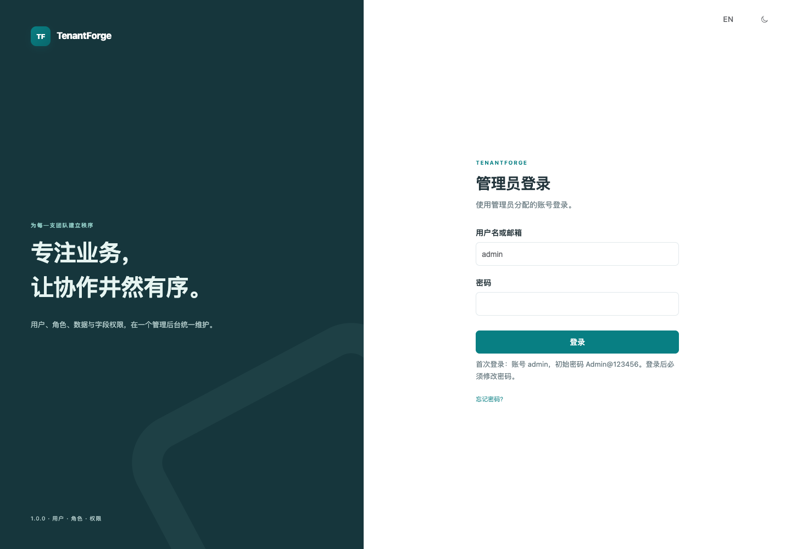

### 工作台与租户切换

工作台集中展示待处理/紧急工单、运行中/失败任务和团队用户，点击卡片进入对应页面；最近动态可继续查看审计记录。数字来自当前账号获授权的数据，左侧组织选择器用于切换租户，菜单按可用权限显示。

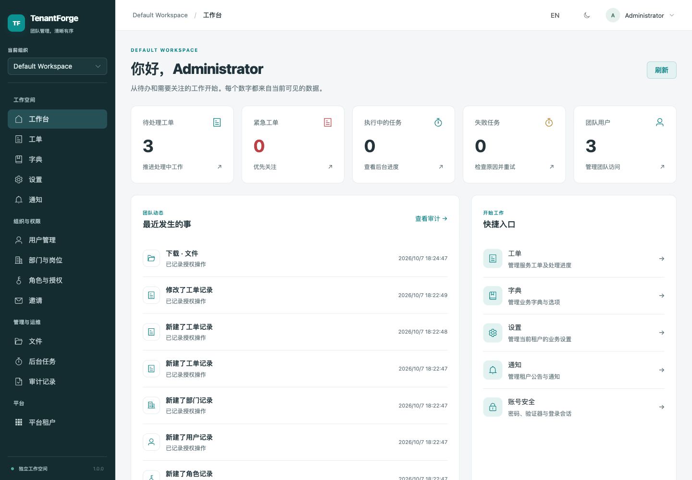

<details>
<summary>查看英文工作台和桌面深色主题</summary>

英文工作台提供同样的待办、团队动态和业务入口，可在顶部切换语言。

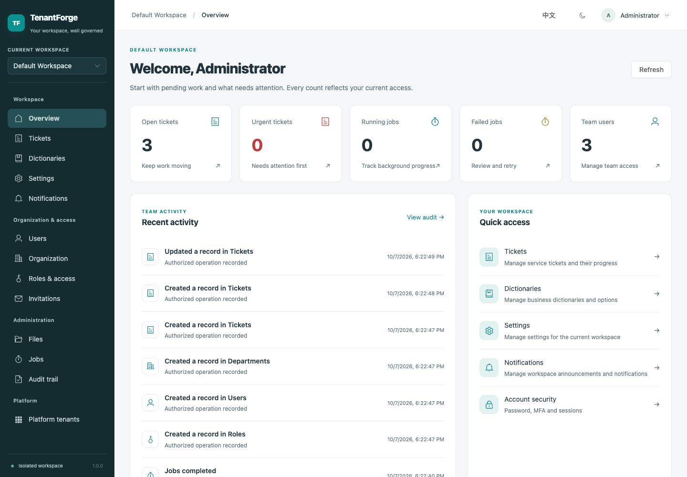

深色主题保留状态颜色、动态记录与导航的可读性。

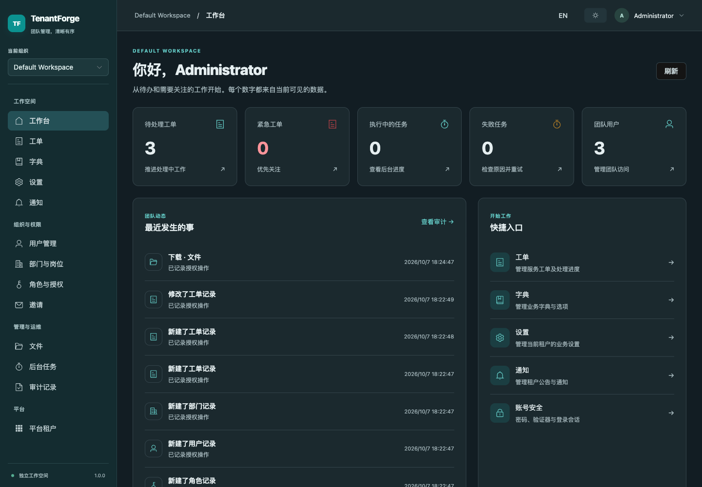

</details>

### 角色与功能权限

在权限矩阵中选择“资源 + 操作”，再配置该条授权的数据范围和字段。查看整个租户的工单，不代表可以修改所有工单。同一操作可以配置多条独立授权；预设只补充缺少的授权，保存前可以检查结果。客服与主管模板会打开新角色草稿，交由管理员审阅。

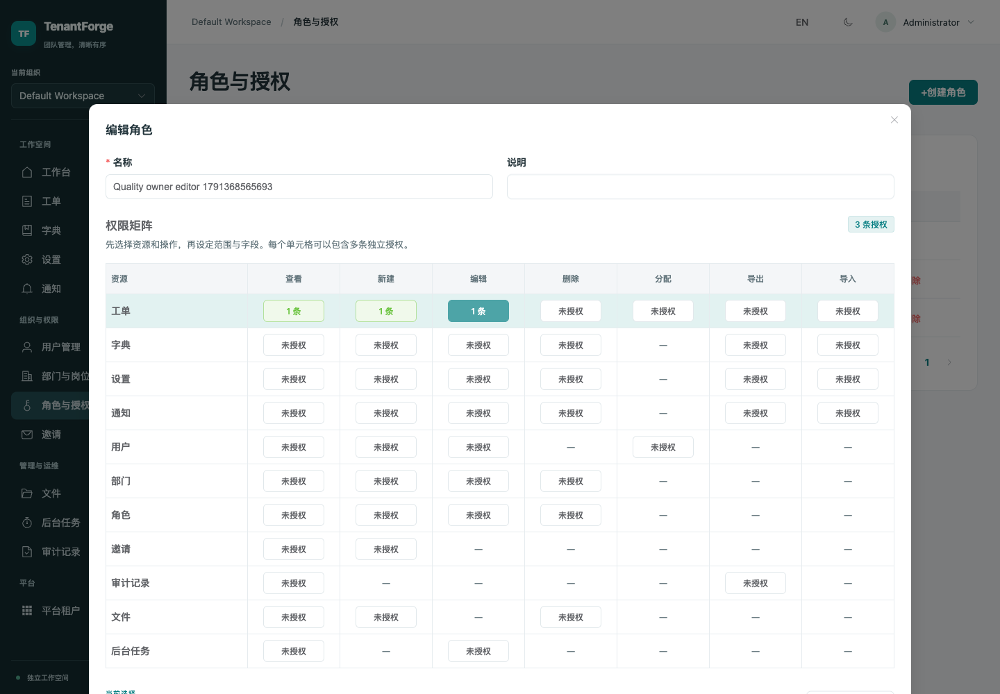

<details>
<summary>查看英文权限矩阵</summary>

英文编辑器同样区分已授权与未授权操作，并显示独立授权数量。


</details>

### 数据权限与字段权限

每项操作可限制为本人、本部门、部门及子部门、指定部门或整个租户，并添加条件。字段权限分别控制读取、写入和敏感值的明文查看，例如客户邮箱和内部备注。查询、数量、详情、修改、导出与任务均在服务端校验权限。

图中“编辑工单”只允许操作本人拥有的记录，客户邮箱和内部备注尚未授权。服务端还会检查管理员是否有权委派这些权限。

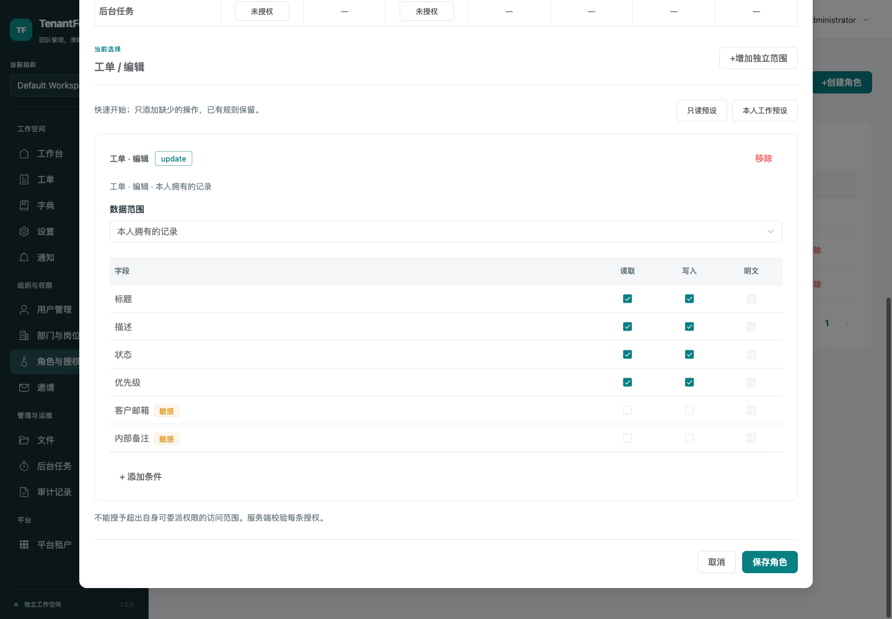

<details>
<summary>查看英文字段与数据范围编辑器</summary>

相同授权可在英文界面中设置，敏感字段需要明确勾选对应权限。

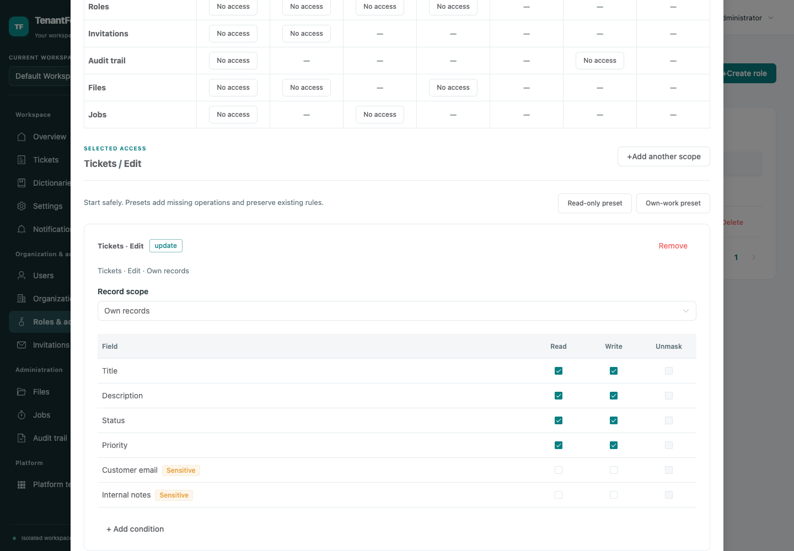

</details>

### 业务列表与逐条操作权限

通用业务页面提供搜索、筛选与分页。每条记录的可用操作由服务端返回；图中的员工能看到两张工单，但只能编辑本人负责的那张，不会因为“能查看”就获得“能修改”。

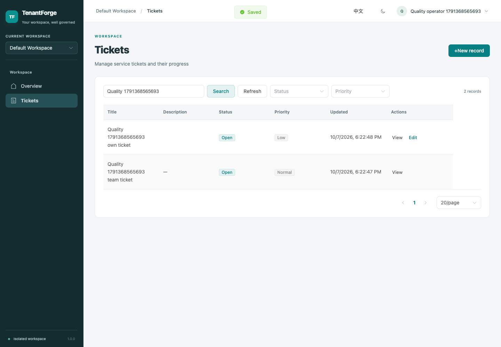

详情抽屉展示已授权字段和可执行的状态流转。字段会按当前权限省略或脱敏；技术标识收在可折叠区域中。

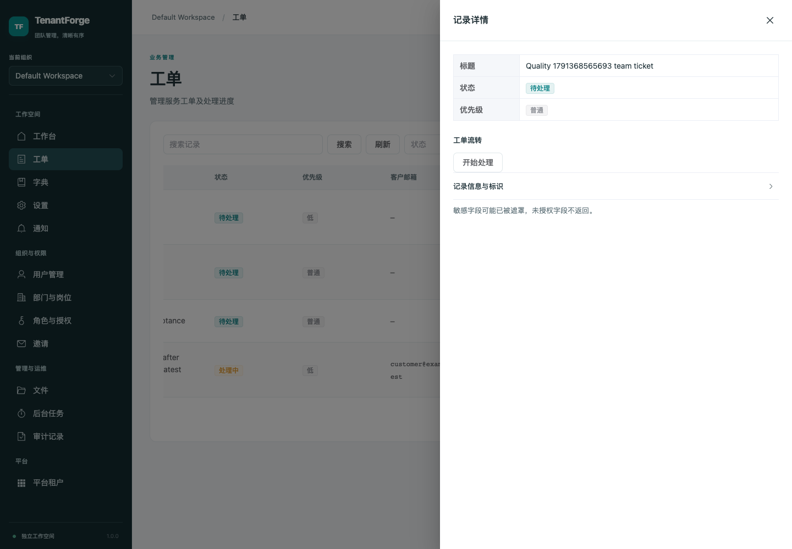

### 完整的企业内部客服流程

管理员创建客服部门，审阅客服/主管角色模板并添加员工。客服代客户登记问题，主管分配给另一位客服；新负责人在“我的待办”中开始处理，记录客户沟通与内部备注，填写必需的解决说明，再关闭工单。重新打开时保留处理历史。

“我的待办”只列出本人负责的待处理/处理中工单；其他队列展示当前有权查看的处理中、已解决、已关闭或全部工单，可继续按关键词、状态与优先级筛选。分配给其他员工后，原负责人失去本人范围访问。

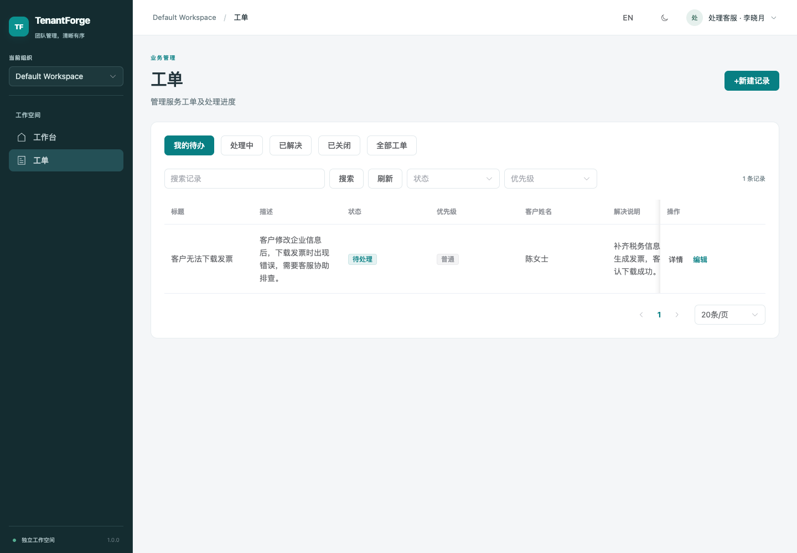

处理记录串联登记、分配、状态变化、客户沟通和内部备注。读取历史时重新检查当前父工单与字段权限；没有备注权限的员工既看不到备注内容，也不能通过总数推断它。版本检查防止覆盖同事的修改，关闭后不能继续追加回复。

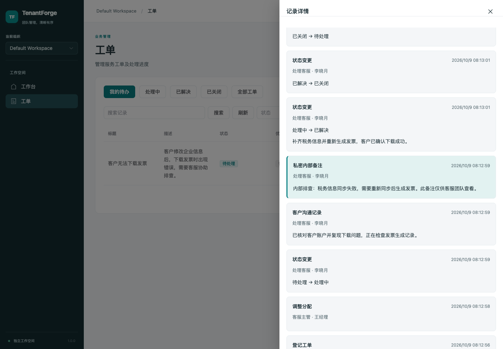

移动端也能查看处理记录；深色主题中的内部备注有单独样式，权限规则与桌面端一致。

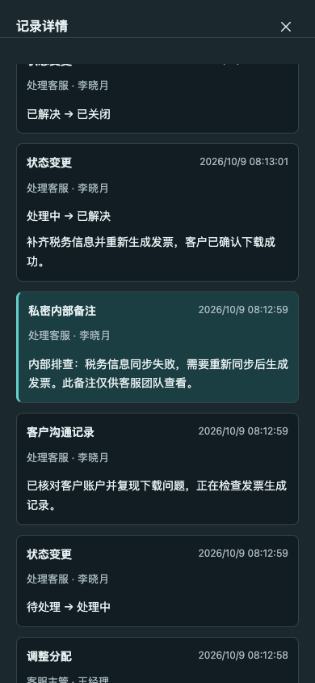

“客户沟通记录”用于员工记录沟通内容，不会向客户发送邮件，也不包含客户自助登录门户。完整操作步骤见[客服使用指南](docs/support-desk.md)。

### 扩展业务模块与后台任务

资产示例通过公共 Go 包注册业务模块、审批操作和盘点任务。任务列表只显示当前员工有权发起的任务类型，声明的输入字段自动生成表单；图中的资产盘点无需额外输入，统计当前可见资产。

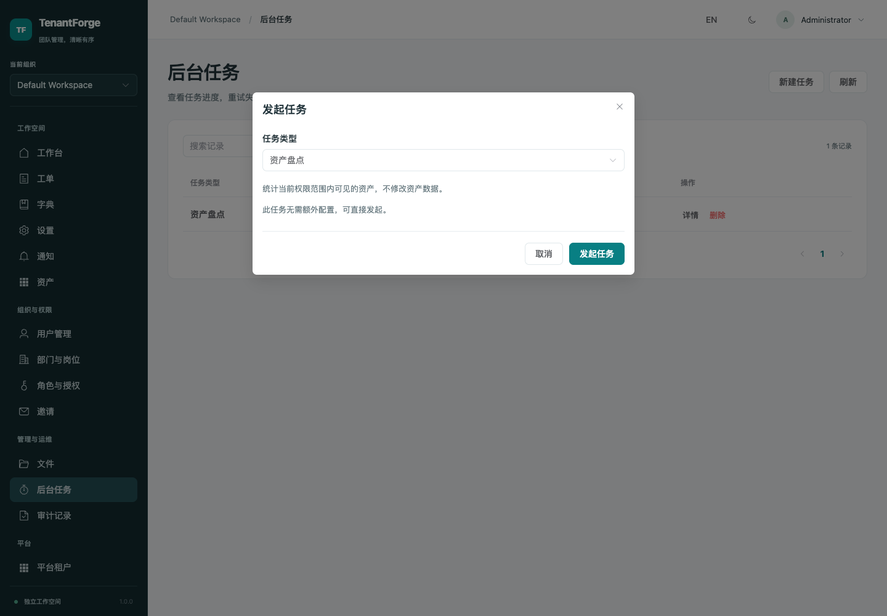

执行后，详情抽屉直接展示“可见资产数”等类型化结果，以及状态和尝试次数。持久任务支持重试/取消，执行时重新校验成员、操作与记录权限。

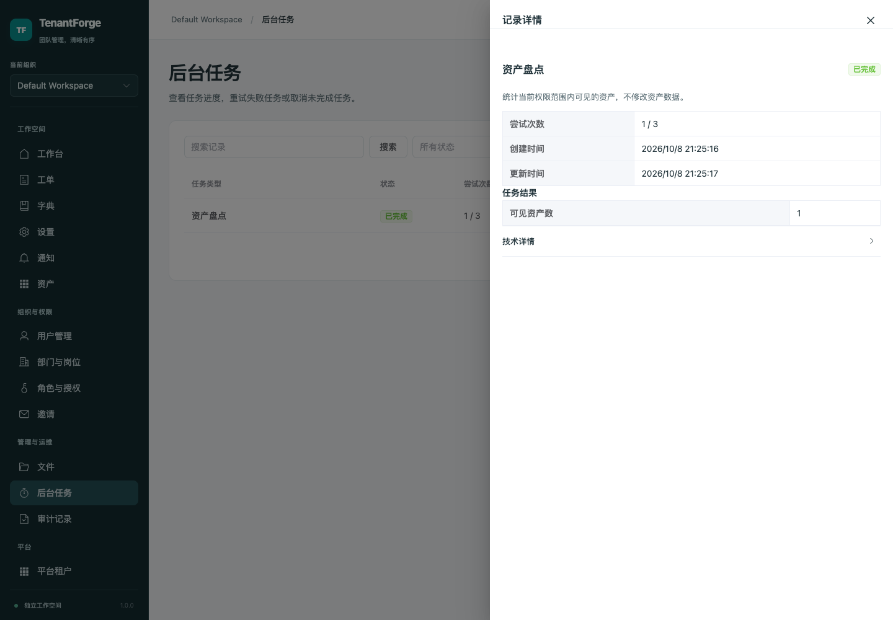

生成的任务表单也适配移动端深色主题。

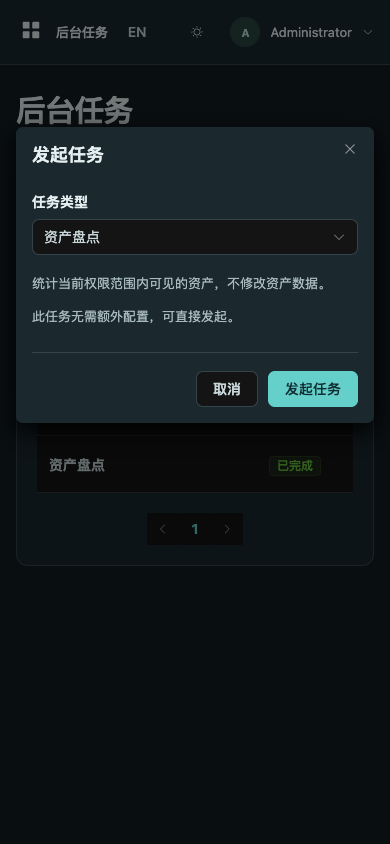

默认程序没有自动启用资产示例。按[扩展指南](docs/extensions.md)运行公共示例或注册自己的业务，无需修改核心路由和授权逻辑。

### 移动端导航与浅色/深色主题

窄屏下侧边栏改为菜单入口，统计卡片重新排列。两张图展示同一组获授权的工作台数据。

| 移动端浅色主题                                                                        | 移动端深色主题                                                                       |
| ------------------------------------------------------------------------------------- | ------------------------------------------------------------------------------------ |
| 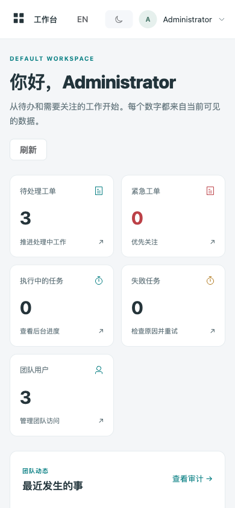 | 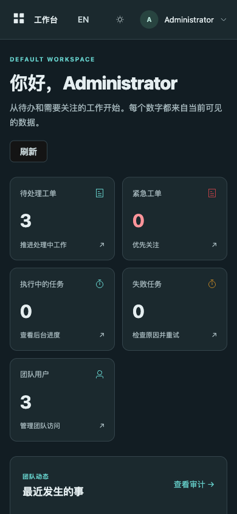 |

## 文档

- [客服工单使用与开发复用](docs/support-desk.md)
- [安装配置](docs/installation.md)
- [权限与安全规则](docs/security.md)
- [API 契约](docs/api-contract.md)
- [OpenAPI 3.1 定义](docs/openapi.json)
- [运维、备份恢复与升级](docs/operations.md)
- [扩展业务模块](docs/extensions.md)
- [依赖选型](docs/dependencies.md)
- [验证记录](docs/verification.md)

```sh
make check
make integration
python3 -m unittest discover -s tests
```

数据库集成测试仅重置独立的 `tenantforge_test`，不会使用业务库。浏览器测试使用独立数据库，具体方法见验证文档。

采用 MIT 许可证，详见 [LICENSE](LICENSE)。
